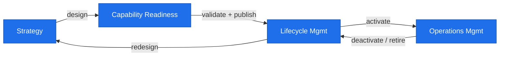
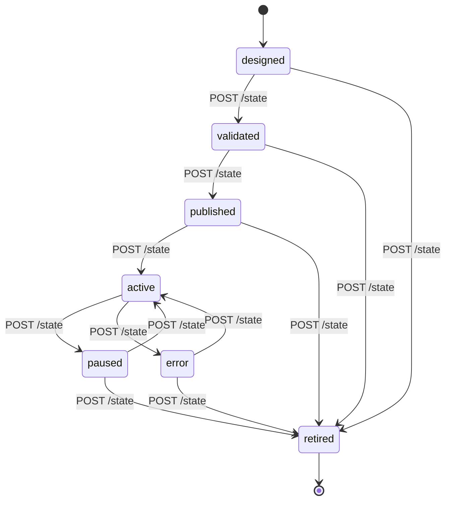
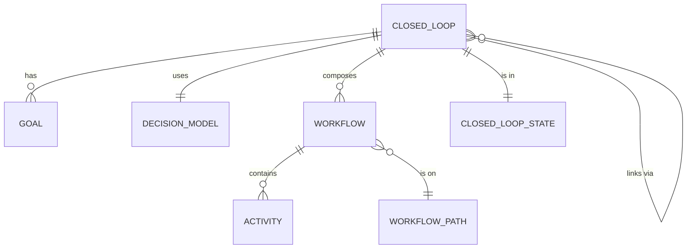

# Closed-Loop-Management

> **Assets for managing closed loops through automation, expressed
> as a service, a data model, and a suite of supporting toolkits.**

Every operational system that adapts to its environment is a closed loop.
A thermostat, a back-pressure regulator, an auto-scaler, a rebalancing
trader. Each takes in a signal, makes a decision, applies an action, and
the action changes the signal that comes back in. **Closed-Loop-Automation-Management
(CLAM)** is the body of work that turns closed loops into first-class
managed artefacts: discoverable, lifecycle-controlled, linkable to one
another, and observable end-to-end.

This repository is not just an API. It is a paradigm.

## Why closed loops need management

Most closed loops today live inside a single application's source code.
The loop is invisible outside that application; you cannot audit it,
cannot move it, cannot retire it cleanly, and you certainly cannot
interlink it with another loop without bolting code together.

Three things are missing:

1. **A typed representation of the loop.** Without one, loops are
   indistinguishable from the rest of the application.
2. **An explicit lifecycle.** A loop is born, validated, published,
   active, paused, retired. Each transition has implications. Without
   an explicit state machine, transitions hide in code paths.
3. **Separation of feedforward and feedback paths.** The action is not
   the same shape as the signal that comes back in. Conflating them
   hides bugs.

CLAM answers all three.

The full argument lives in [`docs/conceptual/paradigm.md`](docs/conceptual/paradigm.md).
What follows is the surface: the assets you can download.

## The paradigm at a glance



The closed-loop lifecycle is the management plane. CLAM implements it as
a REST API, a data model, and a set of toolkits that operate on the
artefacts.

## What you can download

| Asset | Path | What it does |
| --- | --- | --- |
| **Service** | `machines/service/clam/` | FastAPI REST API. CRUD over closed loops, decision models, goals, workflows, activities, links. |
| **Data model** | `schemas/data-model/` | Binding OAS-backed entities (`clam-data-model-1.0.md`) plus the legacy 2022 ERD lineage. |
| **OAS schema** | `schemas/openapi/openapi.json` | The OAS 3.1 contract, validated in CI. |
| **Postman collection** | `schemas/openapi/postman/clam.postman_collection.json` | Downloadable Postman v2.1 collection. |
| **oas-validator toolkit** | `machines/toolkits/oas_validator/` | Profile-level OAS validator (CLAM rules on top of OAS 3.1). |
| **loop-simulator toolkit** | `machines/toolkits/loop_simulator/` | Drives an OODA / MAPE / CUSTOM decision cycle against the API. |
| **erd-to-oas toolkit** | `machines/toolkits/erd_to_oas/` | Reads an .xlsx ERD, emits an OAS schema fragment. |
| **maturity-assessment toolkit** | `machines/toolkits/maturity_assessment/` | Non-technical questionnaire + CSV scoring template. |
| **kpi-calculator toolkit** | `machines/toolkits/kpi_calculator/` | Consumes a simulator trace, emits a KPI report. |
| **Datasets** | `datasets/examples/` | Reference payloads (OODA closed loop, OODA / MAPE / CUSTOM decision models). |
| **Diagrams** | `docs/diagrams/` | Mermaid + PlantUML sources for ERD, lifecycle, state machine, sequence, use cases. |
| **Docs** | `docs/` | API tour, examples, conceptual position paper. |
| **Tests** | `tests/` | 9+ pytest tests covering every endpoint and state transition. |

## The CLAM state machine

Every closed loop runs through this lifecycle. Transitions are explicit
and API-controlled.



PlantUML source: [`docs/diagrams/src/state-machine.puml`](docs/diagrams/src/state-machine.puml).

## The data model



The binding form is at [`schemas/data-model/clam-data-model-1.0.md`](schemas/data-model/clam-data-model-1.0.md).
The legacy 2022 ERD is preserved at
[`schemas/data-model/legacy-2022-erd.xlsx`](schemas/data-model/legacy-2022-erd.xlsx).

PlantUML source: [`docs/diagrams/src/entities.puml`](docs/diagrams/src/entities.puml).

## Quick start (downloadable and testable)

Requires Python 3.12.

```bash
git clone https://github.com/emmanuel-a-otchere/Closed-Loop-Management.git
cd Closed-Loop-Management
pip install -e ".[dev]"
python machines/scripts/seed_db.py

# Start the service
uvicorn machines.service.clam.main:app --reload --port 8000
```

Then open:

- Swagger UI: <http://localhost:8000/docs>
- ReDoc: <http://localhost:8000/redoc>
- Raw OpenAPI 3.1: <http://localhost:8000/openapi.json>

A runnable Postman collection is at
[`schemas/openapi/postman/clam.postman_collection.json`](schemas/openapi/postman/clam.postman_collection.json);
copy-paste cURL examples are in
[`docs/api/EXAMPLES.md`](docs/api/EXAMPLES.md).

### Drive the lifecycle with the simulator

```bash
# Install the loop-simulator extra
pip install -e ".[toolkit-loop-simulator]"

# Drive one of the seeded loops through several cycles
clam-loop-simulator --base http://localhost:8000 \\
    --loop-id <id-from-seed> --cycles 10 --trace trace.jsonl

# Compute KPIs from the trace
pip install -e ".[toolkit-kpi-calculator]"
clam-kpi-calculator --in trace.jsonl --out kpi-report.json
```

### Assess your organisation's maturity

The maturity-assessment toolkit is non-technical. Read the
[`questionnaire`](machines/toolkits/maturity_assessment/questionnaire.md),
fill in the
[`scoring template`](machines/toolkits/maturity_assessment/scoring-template.csv),
and score it:

```bash
clam-maturity-assessment --score scoring-template.csv
```

### Validate an OAS document against the CLAM profile

```bash
pip install -e ".[toolkit-oas-validator]"
clam-oas-validator schemas/openapi/openapi.json
```

### Generate an OAS schema fragment from an ERD

```bash
pip install -e ".[toolkit-erd-to-oas]"
clam-erd-to-oas schemas/data-model/legacy-2022-erd.xlsx \\
    --out schemas/openapi/erd-fragment.json
```

## Repository layout

```
machines/
  service/clam/                # FastAPI REST API
    main.py                    # app entry, OpenAPI metadata
    models.py                  # Pydantic v2 -- OAS source-of-truth
    store.py                   # SQLite-backed store (aiosqlite)
    routers/
      closed_loop.py
      decision_model.py
      health.py
  scripts/                     # Operational scripts
    export_openapi.py          # regenerate schemas/openapi/openapi.json
    postman_export.py          # regenerate the Postman collection
    seed_db.py                 # populate SQLite with example data
  toolkits/                    # Supporting toolkits (technical + non-technical)
    oas_validator/
    loop_simulator/
    erd_to_oas/
    maturity_assessment/
    kpi_calculator/
schemas/
  openapi/openapi.json         # OAS 3.1 snapshot (CI artifact)
  openapi/postman/             # Postman v2.1 collection
  data-model/
    clam-data-model-1.0.md     # OAS-backed entities (binding form)
    legacy-2022-erd.xlsx       # 2022 conceptual ERD (preserved)
datasets/examples/             # Reference payloads
docs/
  conceptual/paradigm.md       # The position paper
  api/OVERVIEW.md
  api/EXAMPLES.md
  diagrams/                    # Embedded diagrams (Mermaid + PlantUML)
tests/                         # pytest + httpx test suite
context/AGENT-DOCTRINE.md      # Governance rules for agents
.github/
  workflows/ci.yml             # pytest + ruff + mypy + OAS validate + cardinal rules
  epics/slice-{1..5}.md        # WBS epic specs
  ISSUE_TEMPLATE/              # bug, feature
  CODEOWNERS                   # cardinal author rule
CHANGELOG.md
LICENSE
pyproject.toml
```

## Repository governance

| Area | Where it lives |
| --- | --- |
| Project board | https://github.com/users/emmanuel-a-otchere/projects/13 |
| Card doctrine | `context/AGENT-DOCTRINE.md` |
| WBS epics | `.github/epics/slice-{1..5}.md` |
| Milestones | `v1.0.0 MVP`, `v1.1.0 Features`, `v2.0.0 Architecture` |

## Development

```bash
pytest                              # run the test suite
pytest --cov=clam                   # with coverage
ruff check machines/service/ machines/scripts/ machines/toolkits/ tests/
mypy machines/service/clam/
```

CI runs the same set on every push (see `.github/workflows/ci.yml`)
plus OAS validation and the D-004 / D-005 / cardinal-author gates.

## Lineage

This repo began in 2022 as an information-engineering exercise around
specifying and managing closed loops. The original 2022 README + ERD 
defined the comprehensive conceptual model: closed loop design studio, 
manager, controller, with sub-functions for design, validation, publication,
catalog, monitoring, orchestration, administration, and choreography.
That conceptual model is the foundation.

**Related Standards:**
- **TM Forum IG1219A AI Closed Loop Automation Management** - https://www.tmforum.org/resources/introductory-guide/ig1219a-ai-closed-loop-automation-management-v2-0-0/
- **TM Forum TR284C AI Closed Loop Automation API** - https://www.tmforum.org/resources/standard/tr284c-ai-closed-loop-automation-apis-v1-2-0/


## License

Apache 2.0.
See [LICENSE](LICENSE).
