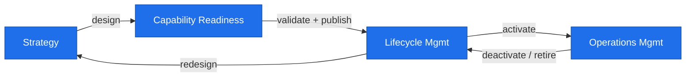

# CLAM Lifecycle

The closed-loop lifecycle has three high-level phases: **Strategy to
Capability**, **Lifecycle Management**, and **Operations Management**.

Source: `docs/diagrams/src/lifecycle.mmd`.