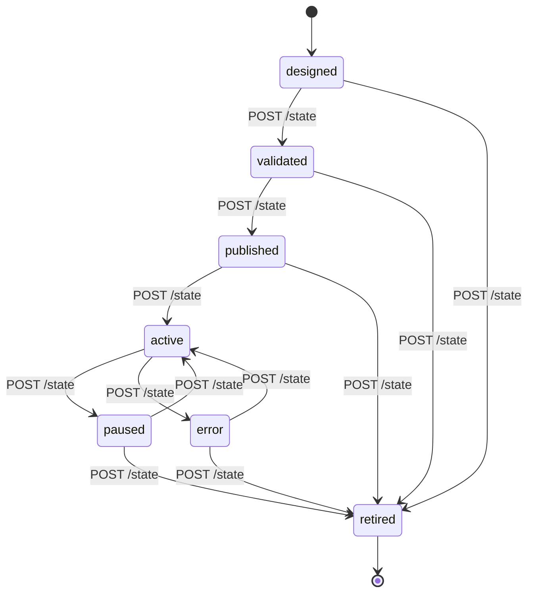

# CLAM State Machine

The closed-loop state machine governs the lifecycle of a single closed
loop instance. Transitions are explicit and API-controlled.

Source: `docs/diagrams/src/state-machine.mmd`.