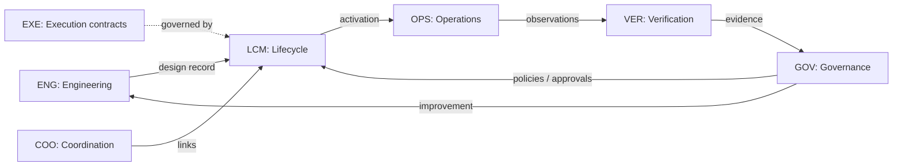

# CLAM Normative Capability Model

## 1. Purpose and scope of this document

This is the normative statement of what the CLAM capability is:
its domains, each domain's purpose, scope, responsibilities, and
the relationships between domains. It is the authoritative
reference for capability questions; other documents (README,
paradigm paper, API docs) reference it rather than restate it.

CLAM is a **management capability**: it defines, represents,
governs, and verifies closed loops. It does not execute them.
This distinction is normative and is elaborated in
[`architecture-boundaries.md`](architecture-boundaries.md).

## 2. Domain definitions

### 2.1 CLAM-CAP-ENG: Closed-Loop Engineering

**Purpose.** Define and validate a closed-loop design against its
intended purpose and operating requirements.

**Scope.** Design record and identity; decision-model
specification; goal and constraint modelling; workflow and
activity composition; dependency and resource specification;
design completeness and consistency assessment; pre-deployment
simulation; acceptance criteria definition.

**Responsibilities.** Establish whether a proposed loop has a
sufficiently complete and consistent design to proceed through
the lifecycle. CLAM is not required to provide a general-purpose
design environment or simulation engine.

**Out of scope.** Performing the loop's work; mandating a design
tooling stack.

### 2.2 CLAM-CAP-LCM: Closed-Loop Lifecycle Management

**Purpose.** Manage closed loops as governed assets throughout
their lifecycle.

**Scope.** Registration and identification; configuration and
version management; lifecycle-state management (designed,
validated, published, active, paused, error, retired);
transition validation and authorisation; release and deployment
traceability; retirement.

**Responsibilities.** Every loop has a uniquely identifiable
lifecycle record; every transition is explicit, authorised, and
recorded in the audit trail. Lifecycle state is distinct from
execution state and from the status of the loop's intended
outcomes.

**Out of scope.** Determining whether the loop is operating
correctly (OPS domain) or achieving its goals (VER domain).

### 2.3 CLAM-CAP-EXE: Execution Integration and Control Boundaries

**Purpose.** Establish the contracts under which external
execution mechanisms participate in a managed closed loop.

**Scope.** Execution-mechanism identification; interface
contracts; input/output expectations; preconditions and
postconditions; action permissions and constraints; status and
failure reporting; execution provenance; human-intervention
requirements.

**Responsibilities.** CLAM defines and governs the contracts; the
designated execution mechanism performs the work. CLAM is
implementation-neutral about the technology used.

**Out of scope.** Executing activities; hosting runtimes.

### 2.4 CLAM-CAP-OPS: Operational Management

**Purpose.** Assess and govern a managed closed loop during
operation.

**Scope.** Operational status and health; observations and
telemetry requirements; goal-progress assessment;
constraint-violation detection; exception and incident handling;
degraded-operation handling; recovery and revalidation;
operational history.

**Responsibilities.** An active lifecycle state never implies
healthy or successful operation. Operational status is assessed
against declared criteria, not inferred from lifecycle state.

**Out of scope.** Replacing domain-specific monitoring systems.

### 2.5 CLAM-CAP-COO: Inter-Loop Coordination

**Purpose.** Govern relationships and dependencies between
multiple closed loops.

**Scope.** Relationship semantics; input/output compatibility;
dependency validation; shared-resource considerations;
conflicting goals and actions; failure propagation; coordination
and escalation; system-level outcome assessment.

**Responsibilities.** The existence of a link between loops is
distinct from the compatibility and safe operation of the
connected loops. Both must be establishable.

**Out of scope.** Central orchestration of loop execution.

### 2.6 CLAM-CAP-VER: Verification and Assurance

**Purpose.** Establish whether a closed-loop design and its
observed behaviour satisfy declared requirements and
constraints.

**Scope.** Design conformance; behavioural verification;
scenario-based testing; outcome verification; evidence
provenance and integrity; verification results and their
interpretation; assurance status; revalidation triggers.

**Responsibilities.** Successful execution is distinct from
verified outcome achievement, and demonstrated failure is
distinct from an indeterminate conclusion. Verification claims
require evidence records with provenance; simulated evidence is
never mistaken for operational evidence.

**Out of scope.** Mandating a specific verification or simulation
engine.

### 2.7 CLAM-CAP-GOV: Governance and Continuous Improvement

**Purpose.** Govern the evolution of closed loops and of the CLAM
capability itself.

**Scope.** Policy and approval governance; version and change
traceability; auditability; conformance reporting; capability
maturity assessment; evidence-based improvement; regression
verification; change impact assessment; compatibility management.

**Responsibilities.** Improvements to a loop or to CLAM itself
are subject to the applicable change-governance requirements
(CR/ADR process, cardinal rules, compatibility review).
Unverified changes do not bypass required controls.

**Out of scope.** An execution-side policy enforcement engine
(enforcement responsibility is declared, not implemented, by
CLAM).

## 3. Domain relationships

Normative relationship statements:

1. A loop enters OPS only through LCM transitions.
2. VER conclusions are inputs to GOV decisions, never the
   reverse.
3. EXE participation in any loop is always via a contract that
   LCM and GOV can reference; there is no implicit execution
   integration.
4. COO relationships are themselves governed objects with
   lifecycle and compatibility status.

## 4. Domain merge/separate decisions (Stage 2 disposition)

Per the canonical proposal's qualification, Stage 2 examined
whether domains should merge or split. Findings:

- The seven domains are retained as specified. No merge is
  warranted: each has distinct failure modes and distinct
  evidence types.
- EXE is retained despite being the thinnest domain because its
  boundary-keeping role (contract governance without execution)
  is the load-bearing architectural distinction of CLAM.
- No eighth domain is introduced at this time. The concept
  disposition (see
  [`data-model/concept-disposition-2026-10.md`](data-model/concept-disposition-2026-10.md))
  attaches every new concept to one of these seven domains.
