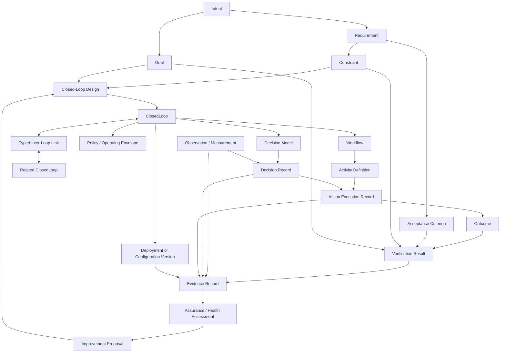

# CLAM Enriched Model: Relationship View

**Status:** Conceptual proposal; not a binding schema.

## Interpretation

- `Activity` describes work; `ActionExecution` records an execution instance. They are not interchangeable.
- `Goal` declares a target; `Outcome` records a resulting condition; `VerificationResult` states whether a criterion is met.
- `EvidenceRecord` supports a claim or result but does not itself guarantee truth or sufficiency.
- `ClosedLoopState` remains lifecycle state. Operational health, execution condition, goal disposition, and assurance disposition are separate dimensions.
- `Policy` and `Constraint` declarations do not automatically enforce themselves. The enforcement point and evidence of enforcement must be identified.
- Inter-loop links require typed contracts and compatibility rules, not merely source/target identifiers.
